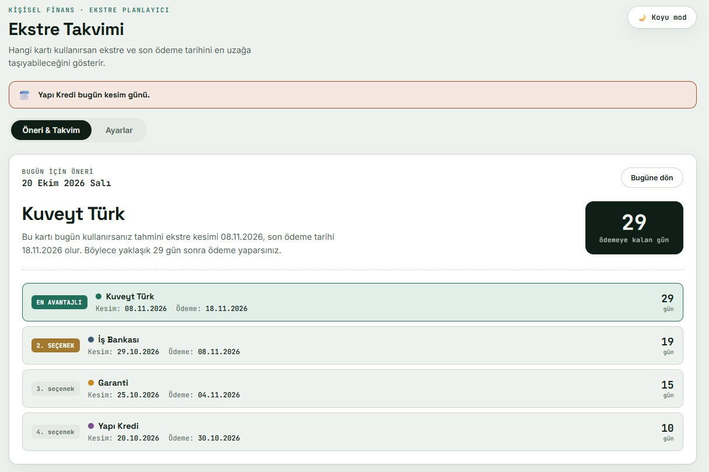

# KrediKarti Ekstre Takvimi

A lightweight personal finance tool that helps you choose which credit card to use for a purchase based on the estimated statement and payment dates. It compares your cards and highlights the one that gives you the longest time until payment.

## Screenshot



## Features

- **Card recommendations:** Ranks your cards by the number of days until the estimated payment date.
- **Calendar view:** Browse dates and see the recommended card and estimated payment date for each day.
- **Custom card settings:** Add, edit, and remove cards. Set each card's statement closing day and the number of days between closing and payment.
- **Reminders:** Show in-app reminders for upcoming statement closing dates and payment dates. Optional browser notifications are available when supported and permitted.
- **Light and dark themes:** Choose a theme; your selection is saved in your browser.
- **Local storage:** Card settings and reminder preferences are saved in the browser on your device.
- **Progressive Web App support:** The app can be installed on supported browsers when served over HTTPS or from `localhost`.
- **Responsive layout:** Designed for desktop and mobile screens.

## How the calculation works

For each card, the app estimates the next statement closing date based on the configured closing day. If that day does not exist in a month, it uses the last day of that month. It then adds the card's configured payment offset to estimate the payment date.

Cards are ranked by the number of days between the selected date and the estimated payment date. The card with the greatest number of days is shown as the recommended option. If two cards have the same result, the app uses the time remaining until their closing dates as a tie-breaker.

These are estimates based on the settings you enter. Always check your bank's actual statement and payment dates.

## Getting started

This is a static web app. It does not require a build step, package manager, or backend server.

Simply start using it on [https://tolgakurtuluss.github.io/kredikarti/](https://tolgakurtuluss.github.io/kredikarti/)

For local testing, you can use Python's built-in server:

```bash
python -m http.server 8000
```

Then open `http://localhost:8000` in your browser.

## Browser data and privacy

The app stores card settings, theme preferences, reminder preferences, and notification history in the browser's `localStorage`. This data is local to the current browser and device; it is not synchronized between devices by the app. Clearing browser site data may remove it.

Browser notifications are optional and require permission. They are triggered while the app is open; this app does not provide background or server-based notifications.

## Disclaimer

Statement and payment dates are calculated estimates, not financial advice or a substitute for information from your card issuer. Verify dates with your bank before making financial decisions.
